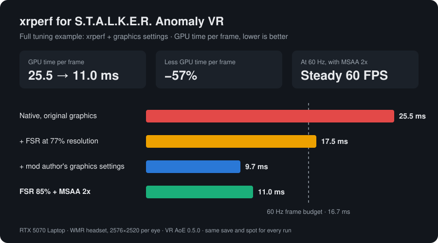

**English** | [Русский](README.ru.md)

# xrperf: performance layer for S.T.A.L.K.E.R. Anomaly VR

An OpenXR API layer that makes [S.T.A.L.K.E.R. Anomaly](https://www.moddb.com/mods/stalker-anomaly) in VR (the **VR AoE** mod, OpenXR) run faster:

- **Upscaling (FSR 1 or NIS).** The game renders at 85% of the headset resolution, and the layer upscales each eye back to full resolution with AMD FidelityFX Super Resolution 1 or NVIDIA Image Scaling.
- **Live switching.** Double-click a `.bat` file to change the upscaler while the game runs.

It works like [openvr_fsr](https://github.com/fholger/openvr_fsr) or vrperfkit, but for OpenXR. Game and mod files are not modified.

## Results

**xrperf on its own gives up to ~30% more performance when your GPU is the bottleneck.** If the game is limited by the CPU instead, expect less.



Measured on one system (RTX 5070 Laptop GPU, WMR headset at 2576×2520 per eye, VR AoE 0.5.0, 60 Hz), same save and spot for every run, MSAA 2x in every run:

| Setup | GPU time per frame |
|---|---|
| Native resolution, original graphics settings | 25.5 ms |
| Native resolution, [recommended graphics settings](#game-graphics-settings) | 13.4 ms (−47%) |
| **Recommended graphics + xrperf (FSR at 85%)** | **11.0 ms (another −18%)** |

What xrperf itself gives, with the game's settings unchanged:

| render_scale | GPU time per frame |
|---|---|
| 0.85 (default) | −18% |
| 0.77 | −31% |

The upscaler itself costs about 0.8 ms (FSR) or 1.0 ms (NIS) for both eyes, already included above. The final setup holds a steady 60 FPS (3 missed frames out of 1084); the frame budget at 60 Hz is 16.7 ms. Your numbers will differ with other GPUs, headsets and scenes.

## FSR or NIS?

Both cost about the same and run on any DirectX 11 GPU.

- **FSR** (default): cleaner edge reconstruction, fewer halos. Good for most people.
- **NIS**: sharper image, but thin contrasty edges (wires, branches against the sky) can get halos. Try it if FSR looks soft to you.

You can compare them live with `FSR.bat` / `NIS.bat`.

## Requirements

- S.T.A.L.K.E.R. Anomaly with the VR AoE mod (OpenXR, DirectX 11)
- Any OpenXR runtime (tested with SteamVR)
- Windows 10/11, 64-bit
- Any DirectX 11 GPU (AMD, NVIDIA, Intel)

## Install

1. Download the zip from [Releases](../../releases) and extract it anywhere outside the game folder, for example `C:\xrperf`. Don't move the folder afterwards.
2. Run `install.bat`. It registers the layer for your Windows user; no admin rights are needed.
3. Start the game through the launcher as usual.

To remove it, run `uninstall.bat` and delete the folder.

### Switch while playing

| File | What it does |
|---|---|
| `FSR.bat` | FSR upscaling (default) |
| `NIS.bat` | NIS upscaling |
| `OFF.bat` | upscaling off; native resolution from the next game start |

Changes apply within a second. Only `render_scale` needs a game restart.

### Settings (`xrperf.ini`)

| Setting | Default | Meaning |
|---|---|---|
| `render_scale` | 0.85 | Share of the headset resolution the game renders. Lower is faster and softer. Applies on game start. |
| `upscaler` | fsr | `fsr`, `nis` or `none` |
| `sharpness` | 0.75 | Sharpening, 0 to 1 |

`logs\xrperf.log` shows FPS, GPU time per frame and what the layer is doing.

## Game graphics settings

The layer alone gives up to about 30%. The biggest single win in the results above came from the game's own graphics settings. These follow the VR AoE author's advice, plus MSAA: the mod turns TAA off in VR, so without MSAA foliage and wires shimmer badly.

| Setting | Set to | Why |
|---|---|---|
| Sun shadow quality | Low | biggest cost in VR |
| Shadow cascades / distance | shorter | lower first, per the mod author |
| Volumetric lights | Off | expensive, rendered twice in VR |
| God rays (sun shafts) | Off | same |
| SSAO / HBAO / GTAO | Off or minimum | |
| Depth of field | Off | never useful in VR |
| SSR (reflections) | Off or minimum | partly broken in VR anyway |
| **MSAA** | **2x** | the mod disables TAA in VR, so this is the only anti-aliasing |
| **MSAA alpha test** | **DX10.1** | smooths foliage and fences; plain MSAA doesn't touch them |

Textures, model detail and view distance can stay high: they cost VRAM more than GPU time.

### Where to change them

**In game:** main menu → `Options` → `Graphics` (the advanced / shader tabs). Change one thing at a time and check.

**Or edit the config file directly** (exact values from the test setup):

1. Close the game. It rewrites the file on exit.
2. Back up `<game folder>\appdata\user.ltx`.
3. Open it in Notepad, find each line below by its name, and replace the value:

```
r2_sun_quality st_opt_low
ssfx_shadow_cascades (15.000000, 30.000000, 80.000000)
r2_volumetric_lights off
r2_sunshafts_quality st_opt_off
r2_ssao_mode disabled
r2_dof_enable off
r3_msaa 2x
r3_msaa_alphatest st_opt_atest_msaa_dx10_1
```

The launcher's "Reset settings" button and some mod updates can reset these; check again after updating.

### Checking performance in the headset

VR AoE has a built-in overlay: press `F11` → `VR Tools` → `Diagnostics` for GPU and CPU frame time. The layer also writes a line to `logs\xrperf.log` every 5 seconds with FPS and the game's GPU time per frame. Aim to stay well under your refresh rate's budget: 16.7 ms at 60 Hz, 13.9 ms at 72 Hz, 11.1 ms at 90 Hz.

## Compatibility and mod updates

xrperf hooks into the game through the standard OpenXR layer mechanism and lives outside the game folder, so game and mod updates don't remove it. A future update could change how the mod renders, for example single-pass stereo. If that happens, the layer stops doing anything and the game keeps running normally; `xrperf.log` will show it. If the mod gets its own upscaler, use `OFF.bat` to avoid upscaling twice.

The layer only attaches to `AnomalyDX11*.exe` and leaves every other OpenXR game alone.

## How it works

- The layer lowers the resolution the runtime recommends to the game. For every eye swapchain the game creates, it creates a full-size swapchain of its own. In `xrEndFrame` it upscales the game's image into that swapchain and submits it instead.
- The upscaler draws on the game's own D3D11 device. It saves and restores the whole pipeline state with `SwapDeviceContextState`, so the engine's cached state stays valid.

An earlier build also had NVIDIA VRS foveated rendering (−27% GPU time), but the mod draws its UI into an eye-sized render target, so VRS made menus and the inventory blocky. It was removed in v0.1.1.

## Building from source

Requires Visual Studio 2022 or Build Tools with the C++ workload (CMake, Ninja and the Windows SDK's `fxc` are included).

```
git clone --recursive https://github.com/kokototo13/xrperf-anomaly-vr
cd xrperf-anomaly-vr
powershell -ExecutionPolicy Bypass -File build.ps1
powershell -ExecutionPolicy Bypass -File tools\package.ps1
```

The output goes to `build\out` and the release zip to `dist\`. `tools\` also has the benchmark script used for the numbers above (`bench.ps1`).

## Credits and licenses

xrperf is released under the [MIT license](LICENSE). It builds on:

- [AMD FidelityFX Super Resolution 1](https://github.com/GPUOpen-Effects/FidelityFX-FSR): MIT
- [NVIDIA Image Scaling SDK](https://github.com/NVIDIAGameWorks/NVIDIAImageScaling): MIT
- [Khronos OpenXR SDK](https://github.com/KhronosGroup/OpenXR-SDK): Apache 2.0

Thanks to the VR AoE author for the mod and the performance advice.
