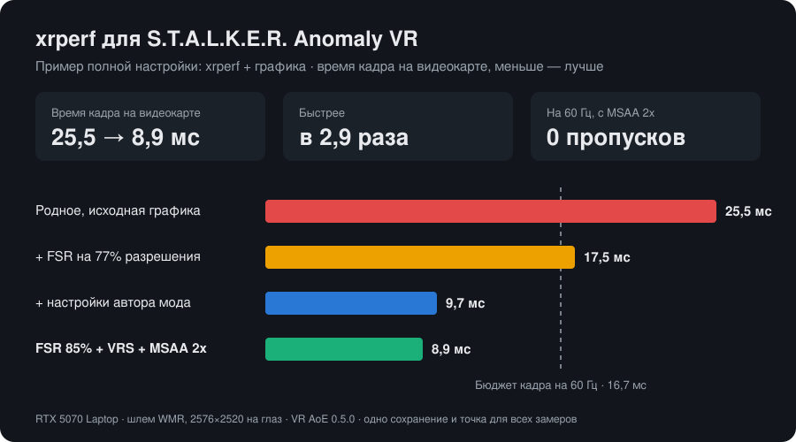

[English](README.md) | **Русский**

# xrperf: ускоритель для S.T.A.L.K.E.R. Anomaly VR

OpenXR-слой, который ускоряет [S.T.A.L.K.E.R. Anomaly](https://www.moddb.com/mods/stalker-anomaly) в VR (мод **VR AoE**, OpenXR):

- **Апскейл (FSR 1 или NIS).** Игра рендерит 85% разрешения шлема, слой растягивает картинку каждого глаза обратно до полного через AMD FidelityFX Super Resolution 1 или NVIDIA Image Scaling.
- **Переключение на ходу.** Двойной щелчок по `.bat` меняет апскейлер прямо в игре.

Это аналог [openvr_fsr](https://github.com/fholger/openvr_fsr) и vrperfkit, только для OpenXR. Файлы игры и мода не меняются.

## Результаты

**Сам xrperf даёт до ~30% прироста производительности, если игра упирается в видеокарту.** Если упирается в процессор, прирост будет меньше.

Замерено на одной системе (RTX 5070 Laptop, шлем WMR, 2576×2520 на глаз, VR AoE 0.5.0), каждый замер на одном сохранении и в одной точке:

| Функция xrperf | Замеренный эффект |
|---|---|
| FSR / NIS на 77% разрешения | −31% времени кадра на видеокарте |
| FSR / NIS на 85% разрешения (по умолчанию) | меньше: примерно −15–20% |
| Цена апскейлера | FSR ~0,8 мс, NIS ~1,0 мс за оба глаза |

### Пример полной настройки: xrperf плюс настройки графики



| Шаг | Время кадра на видеокарте |
|---|---|
| Родное разрешение, исходные настройки графики | 25,5 мс |
| + FSR на 77% разрешения (xrperf) | 17,5 мс |
| + настройки графики по советам автора мода | 9,7 мс |
| **FSR 85% (xrperf) + MSAA 2x** | **11,0 мс** |

Большую часть этого итога дали настройки графики, а не xrperf. На последнем шаге часть выигрыша потрачена на качество картинки: MSAA 2x и разрешение повыше, 85%. Итоговая конфигурация держит стабильные 60 FPS (3 пропущенных кадра из 1084) с включённым MSAA; бюджет кадра на 60 Гц — 16,7 мс. На другой видеокарте, шлеме и в других сценах цифры будут другими.

## FSR или NIS?

По скорости они почти одинаковые, и оба работают на любой видеокарте с DirectX 11.

- **FSR** (по умолчанию): аккуратнее восстанавливает края, меньше ореолов. Подходит большинству.
- **NIS**: картинка резче, но на тонких контрастных краях (провода, ветки на фоне неба) бывают ореолы. Попробуй, если FSR кажется мыльным.

Сравнить можно прямо в игре через `FSR.bat` / `NIS.bat`.

## Что нужно

- S.T.A.L.K.E.R. Anomaly с модом VR AoE (OpenXR, DirectX 11)
- Любой OpenXR-рантайм (проверено со SteamVR)
- Windows 10/11, 64 бита
- Любая видеокарта с DirectX 11 (AMD, NVIDIA, Intel)

## Установка

1. Скачай архив из [Releases](../../releases) и распакуй куда угодно вне папки игры, например в `C:\xrperf`. Потом папку не переноси.
2. Запусти `install.bat`. Он регистрирует слой для твоего пользователя Windows, права администратора не нужны.
3. Запускай игру как обычно, через лаунчер.

Удаление: `uninstall.bat`, потом удали папку.

### Переключение в игре

| Файл | Что делает |
|---|---|
| `FSR.bat` | апскейл FSR (по умолчанию) |
| `NIS.bat` | апскейл NIS |
| `OFF.bat` | апскейл выключен, родное разрешение — со следующего запуска игры |

Срабатывает за секунду. Только `render_scale` требует перезапуска игры.

### Настройки (`xrperf.ini`)

| Настройка | По умолчанию | Что значит |
|---|---|---|
| `render_scale` | 0.85 | Доля разрешения шлема, которую рендерит игра. Меньше — быстрее, но мягче. Применяется при запуске игры. |
| `upscaler` | fsr | `fsr`, `nis` или `none` |
| `sharpness` | 0.75 | Резкость, от 0 до 1 |

В `logs\xrperf.log` пишутся FPS, время кадра на видеокарте и что делает слой.

## Настройки графики в игре

Сам слой даёт до ~30%. А самый большой выигрыш в результатах выше дали настройки графики самой игры. Это советы автора VR AoE плюс MSAA: мод выключает TAA в VR, и без MSAA листва и провода сильно рябят.

| Настройка | Значение | Зачем |
|---|---|---|
| Качество теней солнца | Низкое | самое дорогое в VR |
| Каскады / дальность теней | короче | снижать первым, по совету автора мода |
| Объёмный свет | Выкл | дорогой, в VR считается дважды |
| Лучи солнца (god rays) | Выкл | то же |
| SSAO / HBAO / GTAO | Выкл или минимум | |
| Глубина резкости (DoF) | Выкл | в VR не нужна |
| SSR (отражения) | Выкл или минимум | в VR частично не работает |
| **MSAA** | **2x** | мод выключает TAA в VR, другого сглаживания нет |
| **MSAA alpha test** | **DX10.1** | сглаживает листву и заборы, обычный MSAA их не трогает |

Текстуры, детализацию моделей и дальность прорисовки можно оставить высокими: они нагружают видеопамять больше, чем время кадра.

### Где менять

**В игре:** главное меню → `Options` → `Graphics` (расширенные настройки и вкладка шейдеров). Меняй по одному пункту и проверяй.

**Или прямо в файле конфига** (точные значения из тестовой конфигурации):

1. Закрой игру: при выходе она перезаписывает файл.
2. Сделай копию `<папка игры>\appdata\user.ltx`.
3. Открой его в Блокноте, найди каждую строку ниже по названию и замени значение:

```
r2_sun_quality st_opt_low
ssfx_shadow_cascades (15.000000, 30.000000, 80.000000)
r2_volumetric_lights off
r2_sunshafts_quality st_opt_off
r2_ssao_mode disabled
r2_dof_enable off
r3_msaa 2x
r3_msaa_alphatest st_opt_atest_msaa_dx10_1
```

Кнопка «Сбросить настройки» в лаунчере и некоторые обновления мода могут их сбросить, после обновления проверь.

### Как проверить производительность в шлеме

В VR AoE есть встроенный оверлей: `F11` → `VR Tools` → `Diagnostics` показывает время кадра GPU и CPU. Слой тоже раз в 5 секунд пишет в `logs\xrperf.log` строку с FPS и временем кадра игры на видеокарте. Держись с запасом ниже бюджета своей частоты: 16,7 мс на 60 Гц, 13,9 мс на 72 Гц, 11,1 мс на 90 Гц.

## Совместимость и обновления мода

xrperf подключается к игре через стандартный механизм OpenXR-слоёв и живёт вне папки игры, поэтому обновления игры и мода его не удаляют. Будущее обновление может изменить то, как мод рендерит, например добавить single-pass stereo. Тогда слой просто перестанет что-то делать, а игра продолжит работать как обычно; это будет видно в `xrperf.log`. Если в моде появится свой апскейлер, выключи наш через `OFF.bat`, чтобы не апскейлить дважды.

Слой подключается только к `AnomalyDX11*.exe` и не трогает другие OpenXR-игры.

## Как это устроено

- Слой уменьшает разрешение, которое рантайм рекомендует игре. На каждый swapchain глаза, который создаёт игра, слой создаёт свой полноразмерный. В `xrEndFrame` он апскейлит картинку игры в свой swapchain и отправляет её вместо исходной.
- Апскейлер рисует на D3D11-устройстве самой игры. Состояние конвейера он целиком сохраняет и восстанавливает через `SwapDeviceContextState`, чтобы не сбить кэш состояний движка.

В ранней сборке была ещё фовеация NVIDIA VRS (−27% времени кадра). Но мод рисует интерфейс в цель рендера размером с глаз, и из-за VRS меню и инвентарь становились блочными. В v0.1.1 её убрали.

## Сборка из исходников

Нужна Visual Studio 2022 или Build Tools с C++ (CMake, Ninja и `fxc` из Windows SDK входят в комплект).

```
git clone --recursive https://github.com/kokototo13/xrperf-anomaly-vr
cd xrperf-anomaly-vr
powershell -ExecutionPolicy Bypass -File build.ps1
powershell -ExecutionPolicy Bypass -File tools\package.ps1
```

Сборка лежит в `build\out`, архив для релиза — в `dist\`. В `tools\` есть и скрипт замеров, по которому получены цифры выше (`bench.ps1`).

## Благодарности и лицензии

xrperf распространяется под [лицензией MIT](LICENSE). Использует:

- [AMD FidelityFX Super Resolution 1](https://github.com/GPUOpen-Effects/FidelityFX-FSR): MIT
- [NVIDIA Image Scaling SDK](https://github.com/NVIDIAGameWorks/NVIDIAImageScaling): MIT
- [Khronos OpenXR SDK](https://github.com/KhronosGroup/OpenXR-SDK): Apache 2.0

Спасибо автору VR AoE за мод и советы по производительности.
